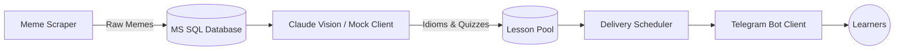

# Memish Tutor — AI-Driven Language Learning Engine

[](https://dotnet.microsoft.com/)
[](https://www.docker.com/)
[](https://docs.microsoft.com/ef/)
[](LICENSE)

> **Memish Tutor** is an automated backend pipeline that turns popular internet culture into bite-sized English lessons. It autonomously scrapes trending memes, synthesizes linguistic explanations and quizzes via Vision LLMs, and delivers scheduled personalized micro-lessons via Telegram.

🔗 **Live Bot:** [@MemishTutorBot](https://t.me/Memish_Tutorbot)
📺 **Demo Video:** [Watch on YouTube](#) **In near future**

---

## Architecture Overview



*For comprehensive sequence and ER diagrams, explore [docs/architecture.md](docs/architecture.md).*

---

## Key Highlights

- **Multimodal AI Pipeline**: Automatically analyzes text in images, extracts conversational idioms, verifies pedagogical quality, and formats interactive quizzes.
- **Pluggable LLM Architecture (`ILLMClient`)**: The AI integration is decoupled from the business logic using the Dependency Inversion Principle. While the production bot relies on Anthropic Claude Vision, this showcase swaps it with a `FakeLlmClient` via Dependency Injection. This lets you run the pipeline locally without API keys while protecting the proprietary system prompts.
- **Extensible Command Routing**: Implements the Command & Strategy Pattern (`ICommandHandler`) for clean, testable Telegram update handling.
- **Automated Retention Engine**: Background services calculate daily user streaks, send reminder notifications, and deliver celebratory achievement milestones.
- **Production-Ready Deployment**: Multi-stage `Dockerfile`, `docker-compose.yml` orchestrating ASP.NET Core, MS SQL Server, and Caddy with automatic SSL certificates.

---

## Architectural Decisions (ADR Summary)

Key trade-offs made during development (read all in [docs/decisions.md](docs/decisions.md)):
1. **Decoupled LLM Interface**: Why `ILLMClient` was created to avoid tight coupling with Anthropic, enabling the injection of `FakeLlmClient` specifically for this public showcase repository to protect proprietary prompts.
2. **Native Hosted Services**: Why ASP.NET `BackgroundService` was selected over Hangfire/Quartz for minimal operational footprint.
3. **Two-Stage Ingestion Pipeline**: Why meme fetching is separated from LLM generation to survive API rate-limiting.

---

## Quick Start (Run Locally in 60 Seconds)

You do **not** need an Anthropic API key to run and review this project. By default, `FakeLlmClient` produces deterministic test lessons.

### 1. Clone & Configure
```bash
git clone https://github.com/your-username/memish-tutor-showcase.git
cd memish-tutor-showcase
cp deploy/.env.example deploy/.env
```

### 2. Launch Containers
```bash
cd deploy
docker compose up -d --build
```

### 3. Run Unit Tests
```bash
dotnet test
```

---

## Known Limitations & Trade-offs

I believe in engineering transparency. Current architectural compromises include:

- **In-Memory Rate Limiting & User States**: User conversational states and rate limiters are currently maintained in application memory and reset upon container restarts. *Next step: Migrate state to Redis.*
- **Single-Node Deployment**: The system runs as a single-instance Docker compose setup without active database replication or automated off-site backups.
- **Third-Party Meme Ingestion Dependency**: Meme ingestion relies on public third-party APIs which lack enterprise SLAs. *Mitigation: Implemented two-stage batch queuing to insulate end-user delivery.*

---

## Tech Stack

* **Runtime:** .NET 10 / ASP.NET Core Web API
* **Database & ORM:** Microsoft SQL Server 2022, Entity Framework Core
* **Messaging & Delivery:** Telegram.Bot API, Telegram Stars payment integration
* **AI/LLM Integration:** Anthropic Claude (Vision), System Prompt Engineering
* **DevOps:** Docker, Docker Compose, Caddy 2 (Reverse Proxy / Auto HTTPS)
* **Testing:** xUnit, Moq

