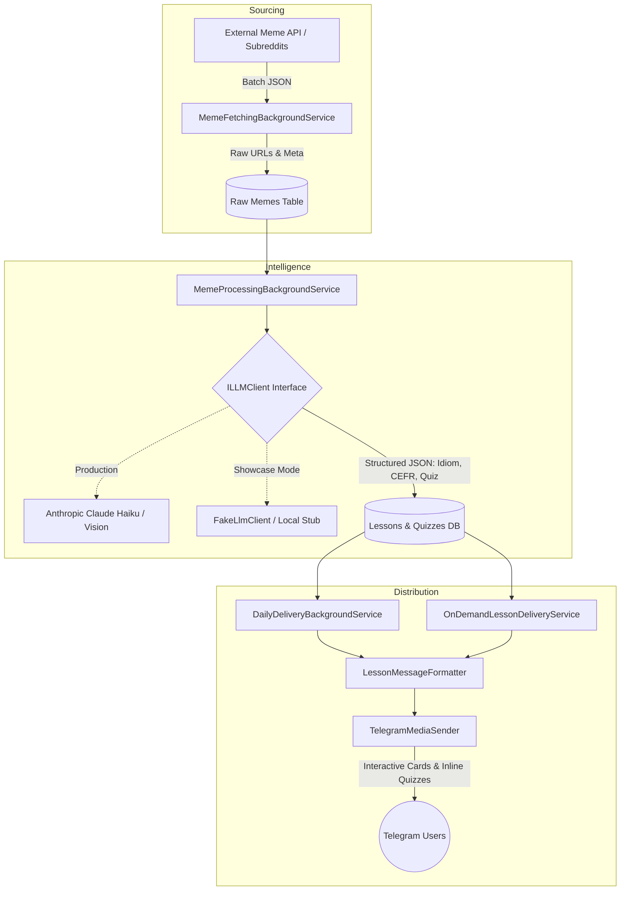
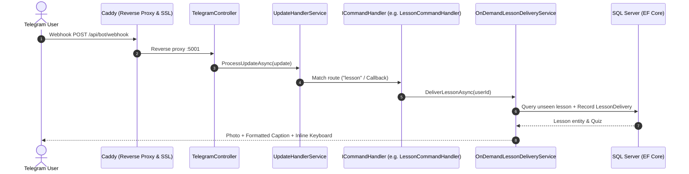
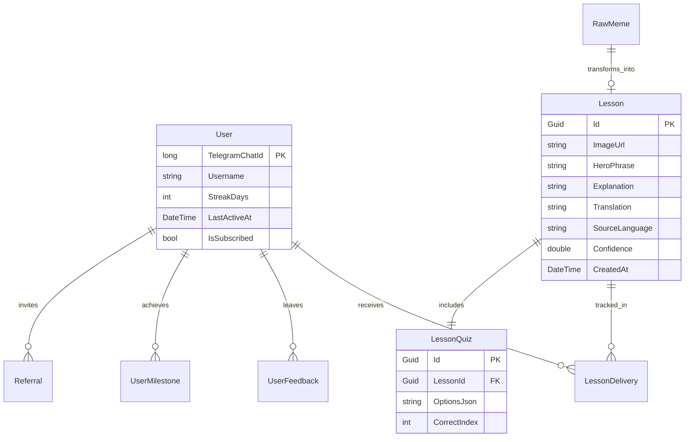

# Memish Tutor — System Architecture

This document outlines the high-level architecture, pipeline processing flow, and data domain model of Memish Tutor.

---

## 1. Automated Meme-to-Lesson Pipeline

Every 2 hours, background services fetch popular internet memes, filter appropriate content, call Claude Vision to generate micro-learning linguistic cards, and store structured lessons in MS SQL Server.

---

## 2. Inbound Telegram Interaction Flow

Handles user commands (`/lesson`, `/feedback`, `/donate`), callback queries, and interactive quizzes via a modular Command Handler pattern.

---

## 3. Domain Entity Model

